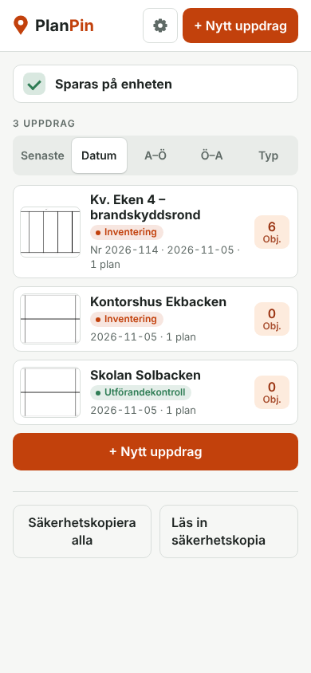
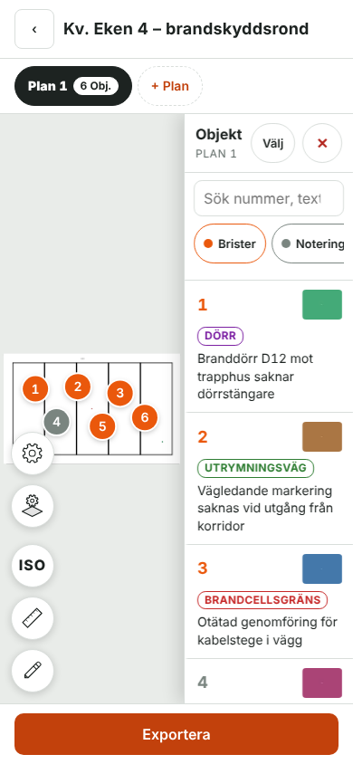
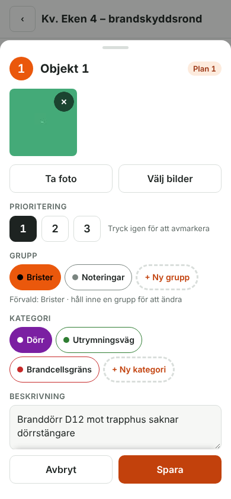
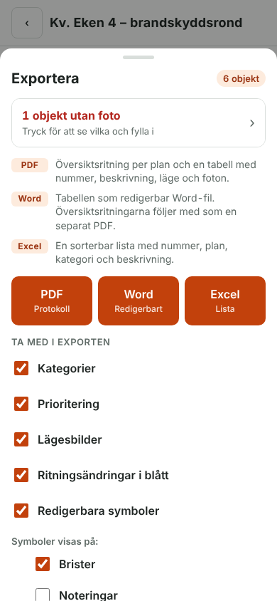

# PlanPin

**Numrerade objekt på ritningar, med foton och beskrivning, och ett färdigt protokoll i PDF, Word eller Excel.**

PlanPin är gjord för besiktningar, inventeringar och kontroller på plats. Du öppnar ritningen i telefonen, trycker där något ska noteras, tar ett foto och skriver vad det gäller. När du är klar exporterar du protokollet direkt från telefonen.

  
  
  
  

## Funktioner

**Uppdrag och ritningar**
- Tre typer av uppdrag: **Inventering** (med prioritering), **Utförandekontroll** (objekttyper med kontrollpunkter enligt BFS 2024:7) och **Anteckningar** (utan ritning).
- Ritningar som PDF eller bild. En PDF med flera sidor kan läggas in som ett plan per sida.
- Flera plan i samma uppdrag, med flikar som visar antalet objekt på varje plan.
- Sortering av uppdragen efter senast använda, datum, namn eller typ.

**Objekt**
- Tryck på ritningen för att sätta ett objekt. Objekten numreras automatiskt och får nya nummer om något raderas.
- Underobjekt, till exempel 4.1, 4.2 och 4.3.
- Håll inne ett objekt och dra för att flytta det. Ett förstoringsglas visar exakt var det hamnar.
- Foton från kameran eller bildalbumet, med markering direkt i fotot: pil, ring och penna i rött, och vridning.
- Beskrivning med snabbtexter och förslag från tidigare objekt.
- Grupper (till exempel Brister och Noteringar, eller egna) som ger objekten deras färg på ritningen och blir egna avsnitt i protokollet (en förvald grupp för nya objekt, eller ingen), och egna kategorier med färger (till exempel Utrymningsväg). Prioritet 1–3.
- **Lägesbild:** ett utsnitt av ritningen runt objektet följer med i protokollet.

**Objektlistan**
- Visas bredvid ritningen. Öppnas med listknappen i marginalen eller med ett svep in från högerkanten.
- Sök på nummer eller text och filtrera på grupp och kategori, på ett plan eller alla.
- Välj flera objekt för att byta grupp, kategori eller prioritet, eller radera dem samtidigt.

**Ritverktyg**
- Rita väggar, dörrar och fönster och sudda bort det som inte stämmer. Verktygen är symboler i en kolumn i vänsterkanten. Inget verktyg är förvalt, så det som redan är ritat kan plockas upp direkt.
- Håll inne något du ritat för att lyfta och flytta det, eller dra i en ände för att ändra längden.
- **Mät** längder och sträckor, med en decimal och i km från 1 000 m. Ange skala eller kalibrera mot en känd längd. En mätning kan sparas med ett namn, till exempel ett gångavstånd. De sparade mätningarna syns bara i Mät och kan exporteras på en egen översiktsritning.
- Ångra ett steg i taget. Ändringarna kan visas i blått i protokollet.

**Symbolverktyget (ISO)**
- ISO 7010-skyltar på ritningen: handbrandsläckare, inomhusbrandpost, brandlarmsknapp, utrymningsplats, återsamlingsplats, utrymningsfönster, utrymningsfönster med stege, räddningsfönster, utrymningsstege, utrymningshiss och vägledande markeringar uppåt, neråt, åt vänster och åt höger, även tillgänglighetsanpassad väg för utrymning, både vita och efterlysande (gula). Skyltarna ligger sorterade efter färg, med de vägledande markeringarna i följd.
- Symbolerna är 7,5 mm (markeringarna 7,5 × 3,75 mm) på ritningens papper. Pappersformatet läses från PDF:en eller väljs när ritningen läggs in.
- **Anteckning med hänvisningspil:** en gul ruta med text i 10 pt och en blå pil till platsen den gäller.

**Export**
- **PDF:** ett avsnitt per grupp med översiktsritning per plan och en tabell med nummer, beskrivning, lägesbild och foton; på översiktsritningarna har numren kategoriernas färger. Symbolerna får en egen översiktsritning, och du väljer vilka gruppers ritningar som också ska visa dem. Under varje översiktsritning finns en symbolförteckning med kategorierna, skyltarna som används, anteckningar och det som kompletterats på plats.
- **Redigerbart i Bluebeam:** på symbolritningen ligger symbolerna och anteckningarna som markeringar, så de kan flyttas, ändras i storlek, vridas och få ny text i Bluebeam och Acrobat.
- **Word:** samma tabell som redigerbar fil, med översiktsritningarna som separat PDF.
- Stora uppdrag delas upp i flera PDF- eller Word-filer med högst 2 000 objekt per fil, så att exporten fungerar även på telefoner med lite minne.
- **Excel:** en sorterbar lista, för utförandekontroller ett eget blad med alla kontrollpunkter, och ett blad med antal av varje symbol.
- **Förhandsvisning:** översiktsritningarna visas medan du väljer vad som ska med, och den färdiga filen kan bläddras igenom sida för sida innan du sparar den.
- Innan du exporterar visas det som saknas, till exempel objekt utan foto eller beskrivning. Du kan fylla i det eller exportera direkt.

**Säkerhet och integritet**
- Allt sparas bara på telefonen. Ingenting laddas upp och ingenting skickas någonstans. En mätare under Inställningar visar hur mycket lagring varje uppdrag tar, och appen säger tydligt ifrån om lagringen blir full.
- Fotons EXIF-data (position, telefonmodell) tas bort när de läses in, så de följer aldrig med i protokollen. Bilder över 260 megapixel nekas innan de läses in.
- Med PIN-kod eller lösenord på hålls flera öppna flikar i samma webbläsare i takt: låses en, låses alla.
- Lås med PIN-kod eller lösenord. Allt som sparas krypteras då (AES-256), och appen låses efter 30 minuter utan aktivitet.
- Säkerhetskopior är vanliga zip-filer (uppgifterna som JSON, ritningar och foton som filer) som kan läsas in på en annan telefon – och öppnas utan appen om det skulle behövas. De kan krypteras med ett lösenord du väljer. Snabbtexterna och kontrollantens namn följer med i kopian.
- Android-appen saknar helt behörighet att använda internet.

**Övrigt**
- I en klunga av objekt behåller ungefär varannan markör sitt nummer och resten visas som små prickar i gruppens färg, så att ritningen syns även med många objekt. Prickarna följer med när du zoomar och får tillbaka numret när det finns plats (kan stängas av).
- Ljust och mörkt läge. Knappar och symboler anpassar sig efter skärmens storlek. Ritverktygen, objektlistan och inställningarna för uppdraget och planet sitter som runda knappar nertill där tummen når dem, till vänster eller höger efter vilken hand du håller telefonen i (Inställningar → Ritverktygen). Animeringar och tips kan stängas av.
- Fungerar utan uppkoppling när den väl är öppnad.

## Kom igång

- **Webbappen** öppnas från repots GitHub Pages-adress. Lägg den på hemskärmen så fungerar den som en vanlig app, även utan uppkoppling.
- **Android-appen** finns under [Releases](../../releases/latest). Den går också att ladda ner från webbappen under **Inställningar → Ladda ner … för Android**.
